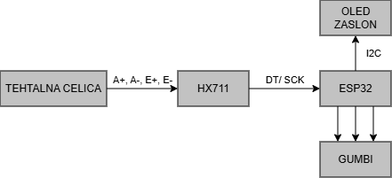
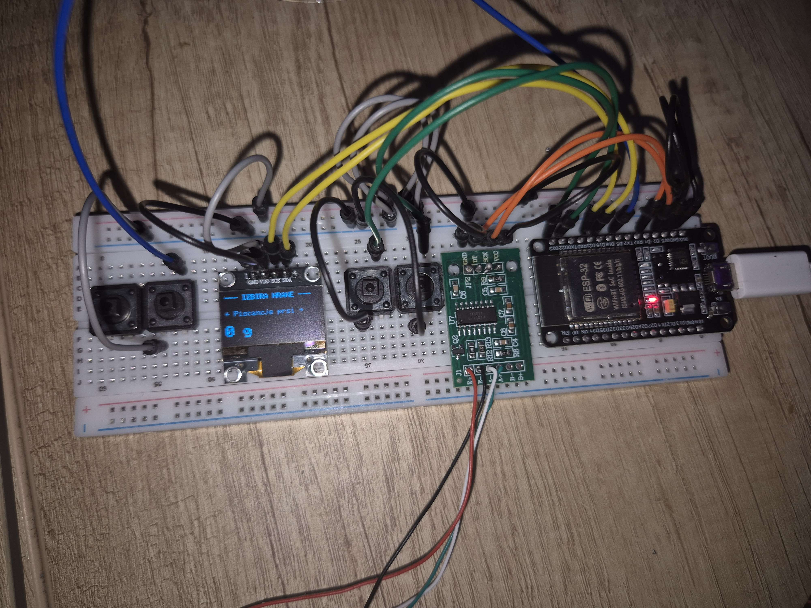
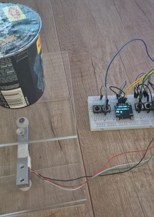

# STM32H750 - Tehtnica s hranilnimi vrednostmi
### Projekt pri predmetu Vhodno-izhodne naprave

## Uvod 
Pri projektu sem želela izdelati nekaj, kar mi bo prišlo prav v vsakdanjem življenju, in ker
veliko časa v dnevu posvetim kuhanju zdravih obrokov, se mi je zdelo super, da bi mi
tehtnica olajšala del z računanjem hranilnih vrednosti.
Za izdelavo projekta sem uporabila naslednje stvari:
- **Mikrokrmilnik ESP32** - stabilen in zadostno število pinov
- **Tehtalno celico do 10 kg** - aluminijast senzor, ki deluje na principu merilnih lističev
za zaznavanje mikroskopskih deformacij materiala ob obremenitvi
- **HX711 24-bitni ADC pretvornik** - specializiran pretvornik in ojačevalnik, ki 128-krat
ojača šibke signale iz tehtnice in jih pretvori v digitalno vrednost, berljivo za
mikrokrmilnik
- **OLED zaslon SSD1306** - zaslon za izpis uporabniškega vmesnika, ki s procesorjem
komunicira preko I2C protokola
- **Gumbi** - za interakcijo z vmesnikom (pomiki po meniju in potrjevanje)

## Postopek dela
### Izdelava konstrukcije
Tehtalna celica deluje tako, da težo bere glede na upogib aluminijastega nosilca. Zato je
potrebno da je pritrjena na dveh delih tako, da ji omogočimo upogib. Umestila sem jo med
dve pleksi plošči in vmes dodala še distančnika - spodnja (nosilna) služi kot podstavek,
zgornja (merilna) pa kot tehtalna površina. Tako je osrednji del celice v zraku in se pod težo
lahko prosto upogne, kar omogoča natančne meritve.
Kasneje sem sicer ugotovila da sem ploščo obrnila narobe. Težavo sem rešila tako, da sem
kot faktor vnesla negativno število.

### Spajkanje
Žičke, ki vodijo iz tehtalne celice je bilo potrebno prispajkati na HX711, in sicer sledeče
(Wheatstonov mostiček):
- **E+** rdeča (pozitiven upogib)
- **E-** črna (negativen upogib)
- **A-** bela (negativen izhodni signal)
- **A+** zelena (pozitiven izhodni signal)
Potrebno je bilo tudi prispajkati nožice, da sem modul lahko stabilno umestila v ploščo. Ta
del se mi je zdel najbolj težaven, saj je bila to moja prva izkušnja s spajkanjem in vajo sem
morala kar nekajkrat ponoviti - tehtnica namreč zelo dolgo časa ni delovala zaradi komaj
opaznega mostička med DT in SCK.

### Povezave na plošči
Čisto na rob plošče sem najprej dala ESP32, ki je pravzaprav osrčje sistema, saj je bilo nanj
treba povezati vse ostalo. Ko je bil ESP povezan na GND in VDD, sem ostale stvari
povezala na pine:
- Zaslon (I2C): SCK → GPIO 21
SDA → GPIO 19
- Komunikacija s HX711: DT → GPIO 15
SCK → GPIO 4
- Uporabniški gumbi: PREV → GPIO 22
NEXT → GPIO 23
MULTI → GPIO 5
Vse komponente so povezane na skupno ozemljitev in napajalno linijo.

### Pisanje kode
Kodo sem spisala pred kalibracijo, ter faktor dodala kasneje - testiranje kode sem izvajala s
konstantno vrednostjo 150 gramov, da sem najprej zagotovila pravilno delujočo kodo, v
primeru, da bi bile kakšne težave s samo tehtnico.
Zaradi omejenega števila prostih pinov sem namesto dodatnega gumba, enega naredila
večfunkcijskega, in sicer tako, da kratek pritisk doda hrano obroku, daljši pritisk pa zaključi
vnos obroka.

### Kalibracija
Za natančne meritve teže v realnem času je bilo treba določiti natančen kalibracijski faktor,
saj HX711 sprva vrača le surove vrednosti.
Uporabila sem že obstoječi program iz knjižnice HX711_ADC. Z njeno pomočjo sem lahko
izmerila faktor tako, da sem sledila navodilom v terminalu, in sicer:
- najprej je tehtnico treba izprazniti, da se zabeleži začetna vrednost neobremenjene
celice (offset oz. tara)
- na pleksi ploščo sem postavila dišečo svečo, katere težo sem predhodno izmerila na
kuhinjski tehtnici
- v Serial Monitor sem vnesla realno vrednost v gramih, program pa je primerjal surovo
spremembo signala z vpisano težo ter izračunal kalibracijski faktor, ki je znašal
-448.06
Dobljeni faktor sem vnesla v glavno programsko kodo in tehtnica je na OLED zaslonu začela
kazati pravilne vrednosti v gramih.

## Glavni program
V programu sem vključila sledeče knjižnice, ki omogočajo delovanje komponent: Wire.h in
SPI.h za komunikacijske protokole, Adafruit_GFX.h in Adafruit_SSD1306.h za izris
na OLED zaslonu, HX711.h pa omogoča branje podatkov iz ojačevalnika tehtalne celice.
Potrebno je bilo tudi inicializirati OLED ekran in mu definirati dimenzije.
Sledilo je dodeljevanje pinov, v skladu s povezavami na breadboardu ter inicializacija
tehtnice oziroma vstavljanje dobljenega kalibracijskega faktorja.
Dodala sem nekaj živil, z ustreznimi hranilnimi vrednostmi na 100 gramov, med katerimi je
mogoče izbirati.
Uredila sem osveževanje zaslona, oziroma privzeti prikaz (teža in vrsta živila). Dodala sem
tudi spremenljivki, ki bosta v nadaljevanju pomagali pri razlikovanju med različnima
pritiskoma na večfunkcijski gumb.
Funkcija setup() se zažene le ob vklopu naprave in pripravi sistem na delovanje.
- Vzpostavi serijsko komunikacijo z računalnikov pri hitrosti 115200 baudov
- Nastavi pine za gumbe v način INPUT_PULLUP
- Zažene I2C komunikacijo za OLED zaslon
- Inicializiza HX711, mu dodeli kalibracijski faktor in izvede funkcijo scale.tare(), ki
tehtnico ob zagonu ponastavi na 0 g
- Na koncu prvič izriše meni na zaslon
V glavni zanki loop() je na začetku časovni mehanizem millis(), ki vsakih 300
milisekund **osveži prikaz**, s čimer omogočimo sproten prikaz spreminjanja obremenitve na
tehtnici.
Program prav tako stalno **preverja stanje pinov za premik po meniju** (gumba PREV in
NEXT). Ko zazna, da je eden od gumbov v stanju LOW (pritisnjen), spremeni foodIdx za 1
navzgor ali navzdol. Vključena je krožna logika, torej po koncu seznama, ob naslednjem
kliku na NEXT, pristanemo na začetku. Premor za 250 milisekund nam preprečuje
zaznavanje nenamernih dotikov gumba.
Najbolj kompleksen del zanke upravlja **večfunkcijski gumb** na pinu 5, ki ločuje med kratkim
in dolgim pritiskom.
- Ob pritisku nanj, si program zapomni sistemski čas (pressedTime) s katerim
ugotovi ali gre za dolg ali kratek pritisk
- Kratek pritisk (< 1s) je namenjen dodajanju hrane k obroku. Program izvede 10
meritev teže in vzame povprečje ter izračuna hranilne vrednosti po formuli
(teža * hranilna vrednost) / 100.
- Dolg pritisk (> 1s) je namenjen zaključku obroka. Na zaslonu se izpiše končni
seštevek vseh kalorij, beljakovin, maščob in ogljikovih hidratov za sestavljen obrok.
Po petih sekundah izpis izgine in tehtnica se ponastavi.

## Zaključek
Ključni izziv pri projektu mi je predstavljal prehod iz teoretičnega načrtovanja v realno
izvedbo, kjer je bilo potrebno veliko poskusov spajkanja ter načrtovanje ogrodja tehtnice.
Naprava nam omogoča enostavno sestavljanje obrokov v realnem času, kar nam pokaže
uporabno vrednost tovrstnih vgrajenih sistemov v vsakdanjem življenju.

